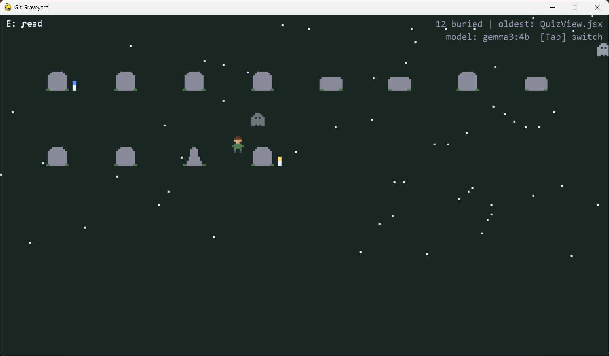
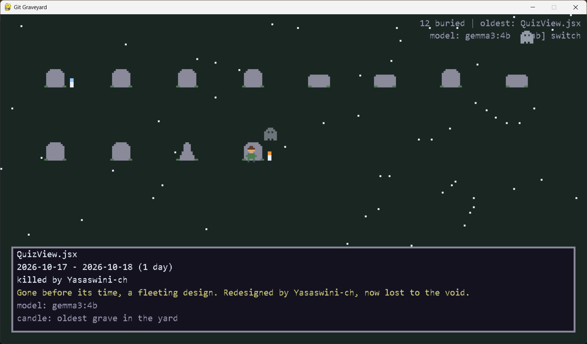
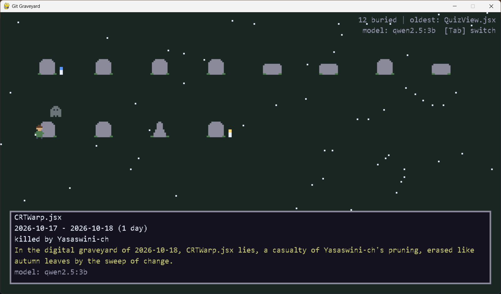
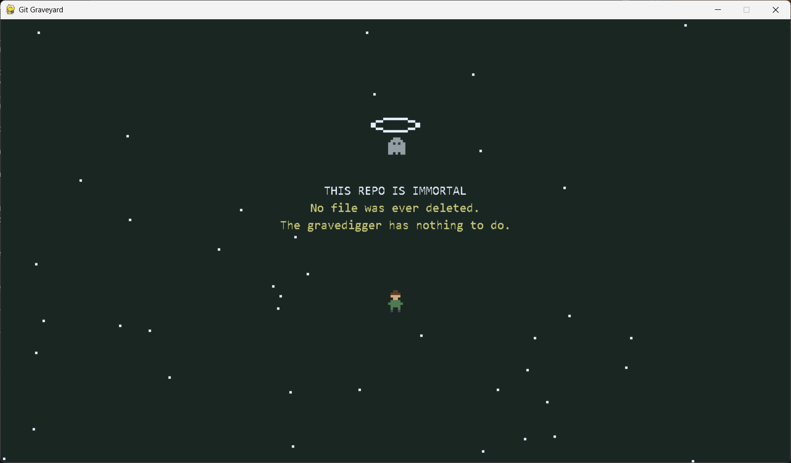

# Git Graveyard

A pixel gravedigger walks a night cemetery. Every tombstone is a file deleted from a git repo; press E at one to read an epitaph written by a local open-weight model. Nothing leaves your machine.



## Screenshots

The same graveyard read through two models (Tab switches between them). In these runs `gemma3:4b` (left) wrote shorter, tidier epitaphs, while `qwen2.5:3b` (right) ran long and leaned on the dates.

| gemma3:4b | qwen2.5:3b |
|---|---|
|  |  |

A repo with no deleted files gets this screen:



## Run

```bash
pip install pygame
ollama pull gemma3:4b          # or run llama-server with a gemma-3 GGUF
python graveyard.py /path/to/repo 40 gemma3:4b graves.json
python game.py
```

`graveyard.py <repo> <limit> <model> <output>` — for llama-server instead of Ollama, switch `URL` at the top of the file.

### Compare two models

```bash
python graveyard.py /path/to/repo 12 gemma3:4b graves.json
python graveyard.py /path/to/repo 12 qwen2.5:3b graves_qwen.json
python game.py graves.json graves_qwen.json    # Tab swaps the epitaph between models
```

## Controls

Arrows/WASD walk, E read, Tab switch model (when two files are loaded), F12 screenshot (`shot.png`), Esc quit.

## What you see

- Tombstone shape follows file type: cross for `.py`, slab for `.css`/`.html`/`.md`/`.txt`, obelisk for images, round for everything else.
- Candles: yellow on the oldest file, blue on the freshest grave, a dimmer one on any file that lived over a year.
- Two ghosts. The second drifts over to you when you stand at a grave.
- A repo with no deleted files gets its own "this repo is immortal" screen.

Optional: put `PressStart2P.ttf` next to `game.py` for a retro font.
